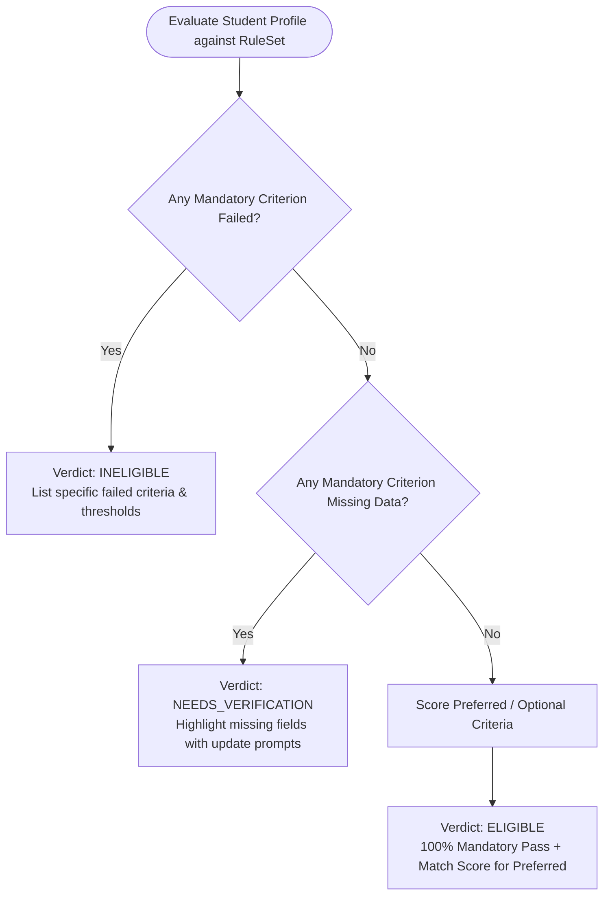

# Prestiq Deterministic Eligibility Engine Specification

**Document Version:** 1.0.0  
**Engine Service:** `services/eligibility-service`  
**Execution Paradigm:** Pure Deterministic Rule Evaluation (Zero-LLM Dependency)  
**Target Runtime:** Java 21 LTS  

---

## 1. Core Philosophy & Regulatory Compliance

In educational financial aid, automated decisions must be **transparent, explainable, and accountable**. 

* **Rule-Based Exclusivity:** The AI / LLM layer is strictly prohibited from making eligibility determinations. Official eligibility verdicts are computed solely by the deterministic rule engine within `eligibility-service`.
* **Zero Hallucination:** Every eligibility verdict is derived through mathematical comparisons and set-membership operations against verified student profile attributes.
* **Auditability & Versioning:** Scholarship criteria change over academic cycles. Rule sets are versioned immutably. Every evaluation stores the exact rule set version used, guaranteeing 100% historical reproducibility.

---

## 2. Evaluation Verdict Taxonomy

The engine evaluates a student's profile against an active rule set and yields one of three definitive outcomes:



| Verdict | Definition | Student UI Presentation |
| :--- | :--- | :--- |
| `ELIGIBLE` | All mandatory criteria have been evaluated and satisfied (`PASS`). | Green badge, "Eligible to Apply", detailed breakdown of matched criteria. |
| `INELIGIBLE` | One or more mandatory criteria evaluated to `FAIL`. | Red badge, "Ineligible", explicit explanations of exact requirements not met. |
| `NEEDS_VERIFICATION` | No mandatory criteria failed, but one or more mandatory criteria could not be evaluated due to missing or ambiguous student data (`MISSING_DATA`). | Amber badge, "Verification Needed", highlighted missing fields with direct CTA to profile editor. |

---

## 3. Supported Criterion Types & Evaluation Rules

The engine uses a **Composite Specification Pattern** implemented in Java. Each criterion is represented by an immutable record or class implementing `CriterionEvaluator`.

```
                    ┌────────────────────────┐
                    │   CriterionEvaluator   │
                    └───────────┬────────────┘
                                │
        ┌───────────────────────┼───────────────────────┐
        ▼                       ▼                       ▼
┌──────────────┐        ┌──────────────┐        ┌──────────────┐
│NumericRange  │        │SetInclusion  │        │BooleanFlag   │
│Criterion     │        │Criterion     │        │Criterion     │
└──────────────┘        └──────────────┘        └──────────────┘
```

### 3.1 Supported Criterion Classes

| Criterion Class | Target Profile Field | Supported Operators | Evaluation Logic |
| :--- | :--- | :--- | :--- |
| **Numeric Threshold** | `cumulativeGpa`, `annualFamilyIncome`, `age`, `creditHours` | `GTE`, `LTE`, `GT`, `LT`, `BETWEEN` | Checks if student numeric value falls within required bounds. Handles GPA scale conversions (e.g., 10.0 scale normalized to 4.0 scale if required). |
| **Set Membership** | `citizenshipCountry`, `stateProvince`, `majorFieldOfStudy`, `educationLevel` | `IN`, `NOT_IN`, `CONTAINS_ANY` | Case-insensitive and normalized set containment check (e.g. `educationLevel IN ['UNDERGRADUATE', 'POSTGRADUATE']`). |
| **Boolean Attributes** | `firstGenStudent`, `militaryVeteran`, `disabilityStatus` | `IS_TRUE`, `IS_FALSE` | Strict boolean equality. |
| **String Pattern / Fuzzy Major** | `majorFieldOfStudy` | `EQUALS`, `MATCHES_DISCIPLINE` | Matches specific major or broader academic cluster (e.g. "Software Engineering" matches "Computer Science / STEM"). |
| **Composite Logical** | Grouped criteria | `AND`, `OR`, `NOT` | Nested evaluation trees allowing complex conditions such as: `(State == 'CA' OR State == 'NY') AND GPA >= 3.5`. |

---

## 4. Rule Set Schema & Data Structure

Scholarship rule sets are stored in JSONB / relational structures and parsed into typed Java objects:

```json
{
  "ruleSetVersion": 2,
  "scholarshipId": 101,
  "effectiveFrom": "2026-01-01T00:00:00Z",
  "criteria": [
    {
      "criterionCode": "MIN_GPA",
      "targetField": "academic.cumulativeGpa",
      "operator": "GTE",
      "targetValue": { "threshold": 3.5, "scale": 4.0 },
      "isMandatory": true,
      "displayName": "Minimum Cumulative GPA",
      "passExplanationTemplate": "Your GPA of {studentValue} meets the minimum requirement of {targetValue}.",
      "failExplanationTemplate": "Requires a minimum GPA of {targetValue}, but your profile records {studentValue}."
    },
    {
      "criterionCode": "CITIZENSHIP",
      "targetField": "demographics.citizenshipCountry",
      "operator": "IN",
      "targetValue": ["US", "CA"],
      "isMandatory": true,
      "displayName": "Citizenship Eligibility",
      "passExplanationTemplate": "Citizenship ({studentValue}) is eligible.",
      "failExplanationTemplate": "Only citizens of {targetValue} are eligible."
    },
    {
      "criterionCode": "FIRST_GEN_PREFERENCE",
      "targetField": "demographics.firstGenStudent",
      "operator": "IS_TRUE",
      "targetValue": true,
      "isMandatory": false,
      "weight": 15,
      "displayName": "First-Generation Student Preference",
      "passExplanationTemplate": "You qualify for first-generation student priority consideration.",
      "failExplanationTemplate": "First-generation preference was not applied."
    }
  ]
}
```

---

## 5. Handling Missing, Ambiguous & Scaled Data

### 5.1 Missing Data Rules
When an evaluated profile field is `null` or empty:
1. If the criterion is **Mandatory** (`isMandatory: true`):
   * Evaluation state becomes `MISSING_DATA`.
   * The rule evaluation continues to inspect remaining criteria to detect any definite `FAIL`s.
   * If any other mandatory criterion produces `FAIL`, the overall verdict is `INELIGIBLE` (a missing GPA cannot overturn an ineligibility due to citizenship restrictions).
   * If no criteria fail, but at least one is `MISSING_DATA`, the overall verdict is `NEEDS_VERIFICATION`.
2. If the criterion is **Optional / Preferred** (`isMandatory: false`):
   * Evaluation state becomes `NOT_EVALUATED`.
   * Bonus points/weights are omitted from the recommendation match score, but overall verdict remains `ELIGIBLE`.

### 5.2 GPA Scale Normalization
* If scholarship specifies a requirement on a 4.00 scale and student reports a 10.00 scale (e.g. Indian academic system):
  $$\text{Normalized GPA} = \left(\frac{\text{studentGPA}}{\text{gpaScale}}\right) \times 4.00$$
* If the grading system is non-linear (e.g., European ECTS grades A–F), the engine checks for explicit grade mapping tables or flags criterion as `NEEDS_VERIFICATION` with an academic counselor note.

---

## 6. Match Scoring for Recommendations

To rank eligible scholarships on the student's dashboard:

$$\text{MatchScore} = \left(\text{MandatoryWeight} \times 1.0\right) + \sum_{i \in \text{Preferred}} \left(\text{Weight}_i \times \text{Status}_i\right)$$

Where:
* Mandatory satisfaction is a prerequisite (score = 0 if `INELIGIBLE`).
* Preferred criteria (e.g., community service, specific minor, underrepresented background) contribute weighted bonuses up to 100%.
* Scholarships with higher match scores appear first in "Recommended For You".

---

## 7. Testing Strategy & Reproducibility

### 7.1 Golden Test Suite
The engine is maintained with a comprehensive matrix of parameterized unit tests covering:
1. Boundary values (e.g., GPA of 3.499 vs 3.500 against a `>= 3.50` threshold).
2. Set inclusivity/exclusivity (case sensitivity, whitespace trimming, ISO country codes).
3. Null safety across every student attribute.
4. Scale conversions and rounding precision (`BigDecimal` operations with `HALF_UP` rounding).

### 7.2 Immutability & Audit Log Guarantee
Every output object is an immutable Java record:

```java
public record CriterionResult(
    String criterionCode,
    String displayName,
    boolean isMandatory,
    CriterionStatus status, // PASS, FAIL, MISSING_DATA, NOT_EVALUATED
    Object studentValue,
    Object targetValue,
    String explanation,
    String remediationAction
) {}

public record EligibilityEvaluationResult(
    Long scholarshipId,
    int ruleSetVersion,
    EligibilityVerdict verdict, // ELIGIBLE, INELIGIBLE, NEEDS_VERIFICATION
    BigDecimal matchPercentage,
    List<CriterionResult> criteriaBreakdown,
    Instant evaluatedAt
) {}
```
