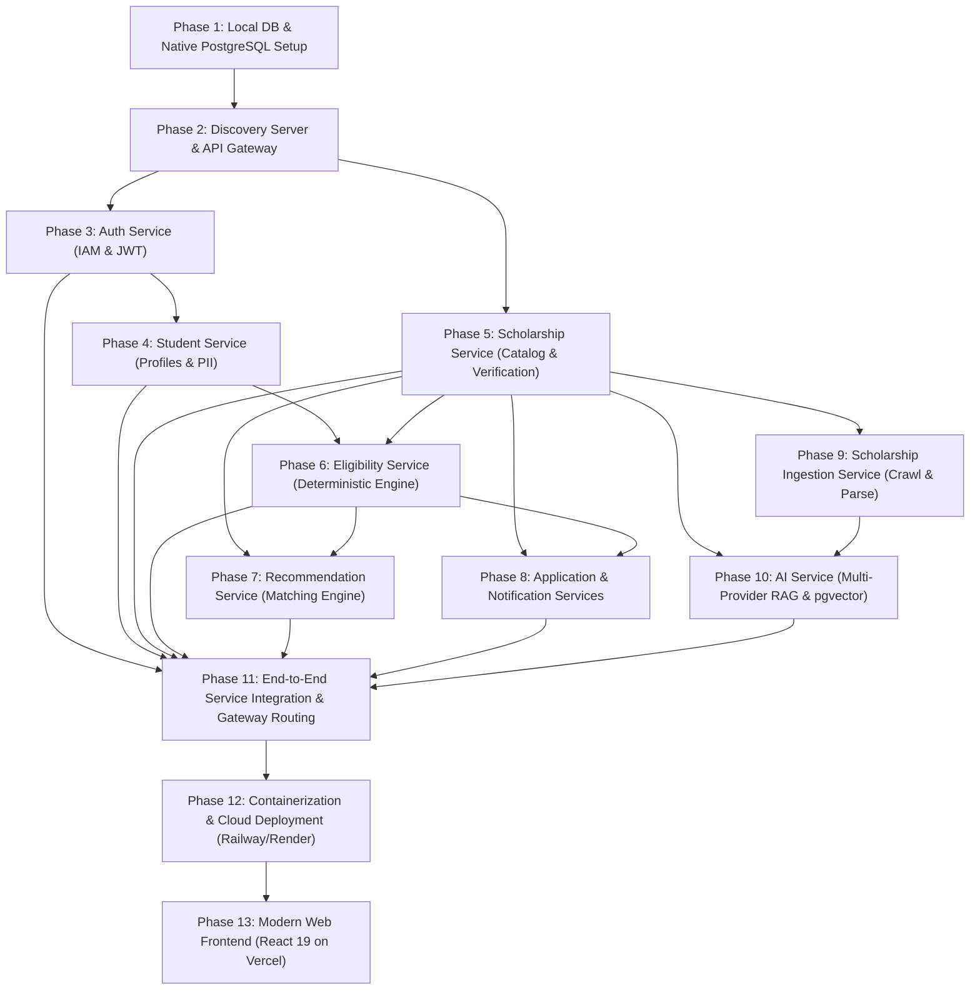

# Prestiq Microservices Phased Implementation Roadmap

**Document Version:** 2.0.0  
**Methodology:** Incremental, Test-Driven Microservices Engineering  
**Hardware Baseline:** MacBook Air M2 (8 GB Unified Memory, 256 GB SSD)  
**Deployment Targets:** Railway / Render (Backend & Storage), Vercel (Frontend)  

---

## 1. Microservices Dependency & Staging Flow

To prevent local RAM exhaustion on an 8 GB MacBook Air M2, services are implemented and validated **incrementally**. Developers run only the active microservice under development alongside native PostgreSQL:

---

## 2. Ordered Implementation Phases

### Phase 1: Local Environment & Native PostgreSQL Infrastructure
* **Focus:** Shared developer environment, database initialization, and memory guards.
* **Deliverables:**
  * Shell script `scripts/setup-local-databases.sh` to initialize 9 logical databases in native PostgreSQL 16 on macOS (`prestiq_auth_db`, `prestiq_student_db`, `prestiq_scholarship_db`, `prestiq_eligibility_db`, `prestiq_recommendation_db`, `prestiq_application_db`, `prestiq_notification_db`, `prestiq_ai_db`, and `prestiq_ingestion_db`) and conditionally enable `vector` extension in `prestiq_ai_db`.
  * Root `.env.example` defining all database URLs, signing keys, and free-tier AI API keys (`GEMINI_API_KEY`, `GROQ_API_KEY`, `CEREBRAS_API_KEY`, `OPENROUTER_API_KEY`).
  * Maven configuration and developer execution guide enforcing JVM memory options (`-Xms64m -Xmx256m -XX:+TieredCompilation -XX:TieredStopAtLevel=1`).
* **Completion Criteria:** PostgreSQL running natively (`brew services start postgresql@16`), all 9 databases created idempotently, and zero Docker containers running.

---

### Phase 2: Discovery Server & API Gateway Foundation
* **Focus:** Routing infrastructure, centralized CORS, and rate limiting.
* **Deliverables:**
  * `services/discovery-server`: Spring Cloud Netflix Eureka server on port `8761` (configured with low memory: `-Xmx96m`).
  * `services/api-gateway`: Spring Cloud Gateway on port `8080` with route definitions, Bucket4j rate limiting, and JWT validation filter.
* **Completion Criteria:** Gateway routes requests to mock downstream endpoints and enforces rate limits.

---

### Phase 3: Auth Service (`auth-service`)
* **Focus:** Identity and Access Management, credentials, and token issuance.
* **Deliverables:**
  * Port `8081`, database `prestiq_auth_db`.
  * Flyway migration `V1__init_auth_schema.sql`.
  * User/Role entities, Argon2id password hashing service.
  * JWT access token (15m) and rotating refresh token endpoints (`/api/v1/auth/register`, `/login`, `/refresh`, `/logout`).
  * Unit and slice tests validating token issuance and compromise detection.
* **Completion Criteria:** 100% test pass on auth flows; refresh token rotation invalidates reused tokens.

---

### Phase 4: Student Service (`student-service`)
* **Focus:** Student academic credentials, demographics, and PII protection.
* **Deliverables:**
  * Port `8082`, database `prestiq_student_db`.
  * Flyway migration `V1__init_student_schema.sql`.
  * Profile endpoints: `GET /api/v1/students/me/profile`, `PUT /api/v1/students/me/profile`.
  * Internal API: `GET /internal/v1/students/{id}/profile`.
  * Log-masking filter preventing student GPA and income from leaking into application logs.
* **Completion Criteria:** Profile CRUD verified with bean validation; PII masked in console logs.

---

### Phase 5: Scholarship Service (`scholarship-service`)
* **Focus:** Verified scholarship catalog, search, and admin verification workflow.
* **Deliverables:**
  * Port `8083`, database `prestiq_scholarship_db`.
  * Flyway migration `V1__init_scholarship_schema.sql` (including PostgreSQL `tsvector` full-text search).
  * Public endpoints: `GET /api/v1/scholarships` (paginated, filtered, sorted), `GET /api/v1/scholarships/{slug}`.
  * Admin endpoints: `POST /api/v1/admin/scholarships`, `PUT /api/v1/admin/scholarships/{id}/verify`.
  * Internal event publishing when an opportunity transitions to `VERIFIED`.
* **Completion Criteria:** Public search filters accurately; unverified opportunities are hidden from public queries.

---

### Phase 6: Eligibility Service (`eligibility-service`)
* **Focus:** Deterministic rule evaluation engine and transparent explanations.
* **Deliverables:**
  * Port `8084`, database `prestiq_eligibility_db`.
  * Flyway migration `V1__init_eligibility_schema.sql`.
  * AST rule evaluators for Numeric, Set Inclusion, Boolean, and Composite criteria.
  * WireMock-backed integration test stubs for `student-service` and `scholarship-service`.
  * Golden test suite passing 100% of the 7 canonical test matrix scenarios (`ELIG-01` through `ELIG-07`).
  * Public endpoint: `GET /api/v1/eligibility/check/{scholarshipId}`.
* **Completion Criteria:** 100% pass on golden test suite with zero AI dependency.

---

### Phase 7: Recommendation Service (`recommendation-service`)
* **Focus:** Personalized scholarship matching algorithms.
* **Deliverables:**
  * Port `8085`, database `prestiq_recommendation_db`.
  * Scoring engine combining mandatory criteria match (prerequisite), preferred criteria weights, and deadline urgency.
  * Endpoint: `GET /api/v1/recommendations`.
* **Completion Criteria:** Returns prioritized scholarships tailored to student profile attributes.

---

### Phase 8: Application & Notification Services (`application-service`, `notification-service`)
* **Focus:** Application stages, status audit history, and deadline reminders.
* **Deliverables:**
  * `application-service` (Port `8086`, `prestiq_application_db`):
    * Saved scholarships and application tracking endpoints (`/api/v1/applications`, `/saved-scholarships`).
    * Immutable status transition history.
  * `notification-service` (Port `8087`, `prestiq_notification_db`):
    * Scheduled background task monitoring upcoming deadlines (30d, 7d, 1d).
* **Completion Criteria:** Status transitions logged immutably; reminder dispatches scheduled accurately.

---

### Phase 9: Scholarship Ingestion Service (`scholarship-ingestion-service`)
* **Focus:** Polite scraping from official sources, HTML/PDF extraction, and deduplication.
* **Deliverables:**
  * Port `8001`, database `prestiq_ingestion_db` (Python 3.13 / FastAPI).
  * HTML extractor (`trafilatura`) and PDF table parser (`pdfplumber`).
  * Cryptographic deduplication (SHA-256) and change detection.
  * Internal client transmitting proposals to `scholarship-service` review queue.
* **Completion Criteria:** Parser accurately extracts structured metadata from sample scholarship PDFs and web guidelines.

---

### Phase 10: Multi-Provider Free-Tier AI Service (`ai-service`)
* **Focus:** Grounded RAG assistant, multi-provider free LLM abstraction, and pgvector embeddings.
* **Deliverables:**
  * Port `8000`, database `prestiq_ai_db` (Python 3.13 / FastAPI).
  * Provider adapters: Google Gemini (1.5 Flash + text-embedding-004), Groq (Llama 3.3 70B + Llama 3.1 8B), Cerebras (Llama 3.1 70B), OpenRouter (:free).
  * HNSW vector indexing in `document_chunks` table via `pgvector`.
  * Prompt injection pre-filter and zero-temperature grounded RAG synthesis with mandatory citations.
  * Automated RAG evaluation benchmark achieving $\ge 95\%$ faithfulness.
* **Completion Criteria:** RAG QA responds with verified citations; provider fallback triggers automatically when rate limits are approached.

---

### Phase 11: End-to-End Service Integration & Gateway Routing
* **Focus:** Full gateway routing, mutual service authentication, and resilience.
* **Deliverables:**
  * Gateway routes mapped to all 9 backend domain services.
  * HMAC-SHA256 inter-service authentication active across all internal endpoints.
  * Resilience4j circuit breakers with graceful degradation fallbacks.
  * Automated integration flow executing student registration -> profile -> recommendations -> eligibility evaluation -> AI assistant -> application tracking.
* **Completion Criteria:** Complete end-to-end journey executes successfully across all services.

---

### Phase 12: Containerization & Cloud Deployment (Railway / Render)
* **Focus:** Production deployment near project completion.
* **Deliverables:**
  * Multi-stage Dockerfiles for all Java and Python services.
  * Docker Compose for local full-stack execution.
  * Cloud deployment manifests for Railway / Render and managed PostgreSQL with `pgvector`.
* **Completion Criteria:** All services deployed and healthy on cloud environment.

---

### Phase 13: Modern Web Frontend (React on Vercel)
* **Focus:** React 19 + TypeScript + Vite + Tailwind CSS SPA deployed to Vercel.
