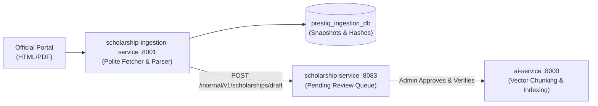

# Prestiq Scholarship Ingestion Service Architecture

**Document Version:** 2.0.0  
**Microservice Name:** `scholarship-ingestion-service`  
**Runtime:** Python 3.13 / FastAPI & Async Crawl Workers  
**Database:** `prestiq_ingestion_db` (PostgreSQL 16)  
**Port:** `8001`  

---

## 1. Service Scope & Boundaries

The `scholarship-ingestion-service` is an independent microservice responsible for:
1. Automated polite acquisition of scholarship data from permitted official portals (government bodies, universities, accredited foundations).
2. HTML extraction (`trafilatura`) and PDF table parsing (`pdfplumber`).
3. Normalization into standard academic and financial schemas.
4. Cryptographic deduplication (SHA-256) and change detection against previously scraped snapshots.
5. Transmitting parsed proposals to `scholarship-service` for Human-in-the-Loop (HITL) review.

---

## 2. Ingestion Pipeline Stages

### 2.1 Stage 1: Acquisition & Polite Crawling
* **Robots.txt & Rate Limiting:** Enforces crawl-delays and respects disallow directives.
* **Transparent User-Agent:** `PrestiqScholarshipBot/1.0 (+https://prestiq.org/bot)`.
* **Snapshot Archival:** Raw responses stored in `prestiq_ingestion_db.scraped_snapshots` with HTTP status, headers, and SHA-256 hash.

### 2.2 Stage 2: Extraction & Normalization
* **HTML Content:** `trafilatura` extracts clean body text and heading hierarchies (`h1`–`h4`), stripping navigation headers, footers, and cookie banners.
* **PDF Guidelines:** `pdfplumber` extracts multi-column text and tabular eligibility matrices (e.g. income thresholds vs household size).
* **Field Normalization:** Standardizes dates to ISO-8601, amounts to `NUMERIC(12,2)` + ISO-4217 currency, and academic degrees to standard enums (`UNDERGRADUATE`, `POSTGRADUATE`).

### 2.3 Stage 3: Deduplication & Change Detection
* **Exact Duplicate:** If `SHA-256(SanitizedText)` matches an active snapshot, the scrape timestamp is refreshed with no downstream action.
* **Content Changed:** If the hash differs for an existing scholarship URL:
  * A semantic diff is computed.
  * If deadlines or criteria have shifted, an update advisory is dispatched to `scholarship-service`:
    `PUT /internal/v1/scholarships/{id}/change-detected`.
* **New Opportunity:** Ingestion service calls `scholarship-service` via internal REST:
  `POST /internal/v1/scholarships/ingested-draft`.

---

## 3. Human-in-the-Loop (HITL) Publishing Workflow

Machine extraction is **never** published directly to students:
1. Ingested opportunities appear in the Scholarship Officer dashboard with status `PENDING_REVIEW`.
2. The officer reviews extracted data side-by-side with the original source URL / PDF excerpt.
3. The officer verifies or adjusts the deterministic eligibility criteria.
4. When approved, `scholarship-service` sets status to `VERIFIED` and issues an internal call to `ai-service`:
   `POST /internal/v1/index/scholarship` to trigger vector indexing.

---

## 4. Error Handling & Dead-Letter Queue (DLQ)

* **Transient Failures (429, 502, 503, 504, Timeout):** Exponential backoff with jitter (max 3 retries: 15s, 60s, 180s).
* **Permanent Failures (404, 410, 403):** Logged in `prestiq_ingestion_db.ingestion_failures`.
* If a previously active scholarship returns 404, `scholarship-service` is notified to flag the opportunity for manual administrator verification.
