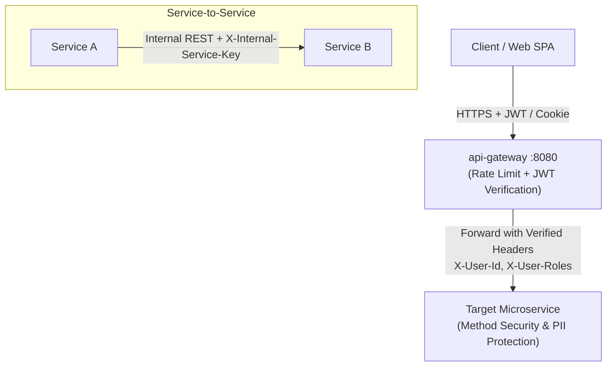

# Prestiq Security & Privacy Architecture — Microservices Specification

**Document Version:** 2.0.0  
**Security Model:** Zero-Trust Distributed Microservices Security  
**Compliance Standard:** OWASP Top 10 (2021), FERPA Student Data Protection Principles  

---

## 1. Gateway-Enforced Distributed Security Architecture

In Prestiq's microservices architecture, **`api-gateway`** acts as the primary policy enforcement point (PEP), protecting all backend services:



### 1.1 Ingress Security Pipeline (`api-gateway`)
1. **TLS 1.3 Termination:** Enforced on HTTPS edge.
2. **Global & Per-Route Rate Limiting (Bucket4j):**
   * `/api/v1/auth/login`: 5 req/min per IP.
   * `/api/v1/assistant/chat`: 30 req/hr per authenticated user.
   * Public discovery: 60 req/min per IP.
3. **JWT Token Validation:** Verifies signature, expiration, and issuer.
4. **Header Sanitization & Injection:**
   * Removes any incoming client-supplied `X-User-*` headers to prevent header injection attacks.
   * Injects authenticated claims: `X-User-Id`, `X-User-Email`, `X-User-Roles`.

---

## 2. Authentication & Credential Lifecycle (`auth-service`)

* **Password Hashing:** Argon2id ($m = 65536 \text{ KB}, t = 3, p = 4$) with 16-byte cryptographically secure random salts.
* **Access Tokens:** Signed JWT (HMAC-SHA256, 15-minute validity).
* **Refresh Tokens:** 64-byte CSPRNG random tokens stored as SHA-256 hashes in `prestiq_auth_db.refresh_tokens`.
* **Single-Use Rotation:** Every refresh rotates the token and invalidates the previous secret. If a previously consumed refresh token is presented, all active sessions for that user are revoked immediately (compromise detection).
* **Cookie Attributes:** `HttpOnly; Secure; SameSite=Strict; Path=/api/v1/auth/refresh`.

---

## 3. Service-to-Service Security & Internal Access Control

Internal microservice endpoints (`/internal/v1/**`) are never exposed directly to the public internet:
1. **Network Layer Isolation:** On Railway/Render, internal endpoints listen only on private DNS overlays (`*.railway.internal`).
2. **Mutual Service Authentication:**
   * Every internal inter-service call carries:
     * `X-Internal-Service-Key: ${INTERNAL_SERVICE_SECRET}`
     * `X-Internal-Timestamp: <epoch_seconds>`
   * Services verify that the shared key matches and that the timestamp is within $\pm 60$ seconds to prevent replay attacks.
3. **Gateway Bypass Defense:** If a public request reaches a microservice directly without passing through the gateway, the missing internal token triggers an immediate `401 Unauthorized`.

---

## 4. Privacy, PII Protection & FERPA Compliance

1. **Student Confidentiality:**
   * Student financial data (`annualFamilyIncome`), disability status, GPA, and citizenship are classified as **Confidential Student Records**.
   * Only the student themselves (via verified `X-User-Id`) and certified administrators can view profile records.
2. **Application Log Masking:**
   * Every Spring Boot service and Python service configures log filters to scrub PII before writing to stdout:
     * Emails masked as: `j***n@domain.com`
     * Passwords, tokens, and authorization headers: `[REDACTED]`
     * GPAs, incomes, and national IDs: `[CONFIDENTIAL_STUDENT_PII]`

---

## 5. Secrets Management & Environment Configuration

1. **Zero Hardcoded Secrets Policy:** No API keys, database credentials, or JWT signing keys are stored in source code.
2. **Environment Variable Injection:**
   ```bash
   # Centralized Environment Variables
   AUTH_DB_URL=jdbc:postgresql://localhost:5432/prestiq_auth_db
   STUDENT_DB_URL=jdbc:postgresql://localhost:5432/prestiq_student_db
   JWT_SIGNING_KEY=your-256-bit-jwt-secret-placeholder
   INTERNAL_SERVICE_SECRET=your-internal-service-hmac-secret-placeholder
   GEMINI_API_KEY=your-gemini-api-key-placeholder
   GROQ_API_KEY=your-groq-api-key-placeholder
   CEREBRAS_API_KEY=your-cerebras-api-key-placeholder
   OPENROUTER_API_KEY=your-openrouter-api-key-placeholder
   ```
3. A sanitized template `.env.example` is maintained at the project root for local onboarding.
