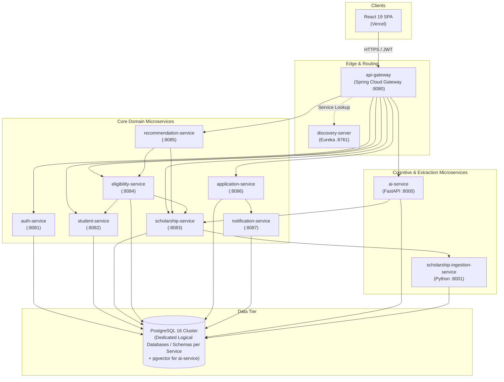

# Prestiq System Architecture — Microservices Specification

**Document Version:** 2.0.0  
**Architecture Style:** Genuine Microservices Architecture  
**Target Cloud Deployment:** Railway / Render (Backend Services & Managed Postgres), Vercel (Frontend)  
**Local Development Baseline:** MacBook Air M2 (8 GB Unified Memory, 256 GB SSD)  
**Tagline:** *Where Merit Meets Opportunity*  

---

## 1. Executive Summary & Architectural Goals

Prestiq is a student-centric scholarship discovery, eligibility assessment, and application lifecycle platform. The architecture is engineered around strict **domain-driven microservices boundaries**, ensuring that each capability is independently developable, testable, deployable, and scalable.

### Core Architectural Pillars
1. **Genuine Microservices:** Distinct deployable services with independent codebases, dedicated database ownership, separate build artifacts, and isolated runtime lifecycles.
2. **Deterministic Eligibility Isolation:** Dedicated `eligibility-service` operating pure, versioned rule evaluators with zero LLM dependence for official determinations.
3. **Pluggable Free-Tier AI Engine:** Dedicated `ai-service` supporting multi-provider LLMs (Google Gemini, Groq, Cerebras, OpenRouter) and free-tier embedding providers with fallback chains and rate-limit tracking.
4. **8 GB Unified Memory Optimization:** Lightweight local development profile enabling incremental development, minimal JVM footprints, native PostgreSQL, and WireMock service stubbing without running heavyweight containers.

---

## 2. Microservices Landscape & Boundaries

The platform consists of **11 distinct deployable microservices** and a managed PostgreSQL infrastructure:



### 2.1 Microservices Catalog & Responsibilities

| # | Service Name | Runtime & Framework | Port | Primary Responsibility & Domain Boundaries |
| :--- | :--- | :--- | :--- | :--- |
| 1 | **`api-gateway`** | Java 21 / Spring Cloud Gateway | `8080` | Reverse proxy, centralized CORS, global rate limiting (Bucket4j), JWT signature verification, routing to microservices via Eureka or environment URLs. |
| 2 | **`discovery-server`** | Java 21 / Spring Cloud Netflix Eureka | `8761` | Dynamic service registration and discovery for local microservice orchestration and cloud VM environments. |
| 3 | **`auth-service`** | Java 21 / Spring Boot 3.3 | `8081` | Identity and Access Management (IAM), Argon2id password hashing, JWT access token issuance (15m), rotating refresh token lifecycle, and role management. |
| 4 | **`student-service`** | Java 21 / Spring Boot 3.3 | `8082` | Student academic profiles, demographics, GPA, household income, eligibility attributes, and PII protection/log masking. |
| 5 | **`scholarship-service`**| Java 21 / Spring Boot 3.3 | `8083` | Verified scholarship catalog, source attribution, full-text search, filtering, administrative verification workflow, and audit logging. |
| 6 | **`eligibility-service`**| Java 21 / Spring Boot 3.3 | `8084` | Versioned scholarship rule set registry, AST-based deterministic rule evaluation, criterion-level pass/fail/needs-verification outcomes, and GPA scaling. |
| 7 | **`recommendation-service`**| Java 21 / Spring Boot 3.3 | `8085` | Personalized scholarship matching, ranking algorithms combining deterministic eligibility scores with student preferences and deadline urgency. |
| 8 | **`application-service`**| Java 21 / Spring Boot 3.3 | `8086` | Scholarship application stage tracking (`SAVED`, `IN_PROGRESS`, `SUBMITTED_EXTERNALLY`, `AWARDED`), status transition audit history, and student application notes. |
| 9 | **`notification-service`**| Java 21 / Spring Boot 3.3 | `8087` | Deadline countdown engine, scheduled notification dispatches, email alert templates, and retry tracking. |
| 10 | **`ai-service`** | Python 3.13 / FastAPI | `8000` | Grounded RAG assistant, multi-provider free LLM abstraction (Gemini, Groq, Cerebras, OpenRouter), pgvector HNSW indexing, prompt-injection defense, and citation verification. |
| 11 | **`scholarship-ingestion-service`** | Python 3.13 / FastAPI & Workers | `8001` | Polite scraping from permitted official sources, PDF/HTML document extraction, text normalization, SHA-256 deduplication, and change detection. |

---

## 3. Database Ownership & Isolation Strategy

Prestiq strictly enforces **Database-per-Service**. No service is permitted to read from or write directly to another service's database tables.

### 3.1 Multi-Database / Schema Architecture
To maintain absolute domain isolation while remaining resource-efficient on an 8 GB development laptop and cloud PaaS:
* A single PostgreSQL 16 cluster hosts **isolated logical databases** (or strictly isolated schemas with dedicated PostgreSQL database users/roles).
* Each service manages its own migrations independently via **Flyway** (`db/migration/`) or **Alembic** (for Python services).
* Direct foreign keys across distinct service databases are **strictly prohibited**. Inter-service references use immutable UUIDs or Long identifiers (e.g., `studentId: UUID`, `scholarshipId: Long`).

| Microservice | Dedicated Database / Schema | Storage Characteristics |
| :--- | :--- | :--- |
| `auth-service` | `prestiq_auth` | Users, roles, user_roles, refresh_tokens |
| `student-service` | `prestiq_student` | Student profiles, academic credentials, demographics |
| `scholarship-service` | `prestiq_scholarship` | Scholarships, scholarship_sources, provider_metadata, audit_logs |
| `eligibility-service` | `prestiq_eligibility` | Scholarship_rule_sets, eligibility_criteria, evaluation_records |
| `recommendation-service` | `prestiq_recommendation` | Recommendation_caches, student_preference_profiles |
| `application-service` | `prestiq_application` | Scholarship_applications, saved_scholarships, application_status_history |
| `notification-service` | `prestiq_notification` | Deadline_reminders, notification_logs, delivery_attempts |
| `ai-service` | `prestiq_ai` | Document_chunks, dense vector embeddings (`vector(768)` or `vector(1536)` via `pgvector`) |
| `scholarship-ingestion-service`| `prestiq_ingestion` | Scraped_snapshots, content_hashes, crawl_jobs, raw_extracts |

---

## 4. Inter-Service Communication & Resilience

### 4.1 Synchronous Communication Patterns
* **Clients to Services:** All external requests enter through `api-gateway` on port `8080`. The gateway authenticates JWTs, extracts user claims, and forwards requests with sanitized headers (`X-User-Id`, `X-User-Roles`, `X-User-Email`).
* **Service-to-Service REST:** Microservices communicate using **Spring Cloud OpenFeign** or **Spring WebClient** (declarative HTTP clients).
  * Example: When `eligibility-service` evaluates eligibility, it fetches the student profile from `student-service` (`GET /internal/v1/students/{id}`) and rule sets from `scholarship-service` (`GET /internal/v1/scholarships/{id}/rules`).
* **Service-to-Service Security:**
  * Requests between microservices carry mutual pre-shared service keys (`X-Internal-Service-Key`) or HMAC request signatures to prevent unauthorized internal invocation.

### 4.2 Resilience & Fault Handling
* Every inter-service OpenFeign / HTTP client is wrapped with **Resilience4j**:
  * **CircuitBreaker:** Trips to `OPEN` if downstream error rate exceeds 50% over a sliding window of 10 requests.
  * **Timeouts:** Connect timeout = 2s; Read timeout = 5s (extended to 15s for AI completions).
  * **Fallbacks:**
    * If `ai-service` is unreachable, `api-gateway` returns a 503 with a structured problem detail: *"AI Assistant is temporarily unavailable. Core scholarship discovery and application tracking remain fully functional."*
    * If `notification-service` is down, `application-service` queues reminder requests locally and retries via a scheduled fallback task.

---

## 5. Discovery Server & Cloud Deployment Assessment

### 5.1 Eureka in Local vs. Cloud Environments
* **Local Development:** `discovery-server` (Eureka) runs on `http://localhost:8761`. Spring Cloud Gateway and microservices register their local host/port dynamically.
* **Railway / Render Cloud Deployment Assessment:**
  * Dynamic PaaS platforms (Railway and Render) utilize private DNS overlays (e.g. `auth-service.railway.internal:8081`).
  * Eureka registration inside PaaS containers can suffer from ephemeral internal IP re-assignments and single-dyno sleep cycles.
  * **Solution (Dual-Profile Routing):**
    * In profile `local`: Spring Cloud Gateway uses `lb://SERVICE-NAME` with Eureka discovery.
    * In profile `production` (Railway/Render): Spring Cloud Gateway can either route via Eureka OR route directly to environment-configured private URLs (e.g., `http://auth-service.railway.internal:8081`) via Spring Cloud Gateway route definitions:
      ```yaml
      spring:
        cloud:
          gateway:
            routes:
              - id: auth-service
                uri: ${AUTH_SERVICE_URL:lb://auth-service}
                predicates:
                  - Path=/api/v1/auth/**
      ```

---

## 6. Low-Memory Local Development Strategy (8 GB MacBook Air M2)

Running 11 microservices simultaneously on an 8 GB MacBook Air M2 would severely stress unified RAM if unoptimized. The following engineering strategy ensures a smooth, responsive developer experience:

### 6.1 Core Local Rules
1. **Never Run All Services Simultaneously During Routine Coding:**
   * Developers work on **one service at a time** (e.g., implementing a new feature in `student-service`).
   * Downstream dependencies are stubbed using **WireMock** or lightweight Spring test profiles (`@Profile("dev-standalone")`).
2. **Aggressive JVM Tuning for Development:**
   * Spring Boot 3.3 on Java 21 can run with a tuned heap and tiered compilation:
     ```bash
     export JAVA_TOOL_OPTIONS="-Xms64m -Xmx192m -XX:+TieredCompilation -XX:TieredStopAtLevel=1 -XX:CICompilerCount=2"
     ```
   * `-XX:TieredStopAtLevel=1` enables C1 compilation without C2, reducing startup time by 60% and keeping JVM memory footprint bounded to ~120–180 MB per service.
3. **Native PostgreSQL Only (Zero Docker Desktop in Local Dev):**
   * Run PostgreSQL natively via Homebrew: `brew services start postgresql@16`.
   * Native Postgres uses only ~35–50 MB of RAM on macOS, compared to 2.5 GB to 4 GB consumed by the Docker Desktop Linux VM.
4. **Zero Local LLMs or Local Embedding Models:**
   * Running Ollama or local sentence-transformers consumes 2 to 5 GB of unified memory.
   * `ai-service` calls free-tier cloud APIs over HTTPS (Gemini, Groq, Cerebras) using lightweight Python `httpx`/`requests`, consuming $< 70\text{ MB}$ RAM.

### 6.2 Service Startup & Shutdown CLI Reference
Each service can be started and stopped individually from terminal tabs:

```bash
# 1. Native PostgreSQL (Always Running)
brew services start postgresql@16

# 2. Discovery Server (Port 8761)
cd services/discovery-server && ./mvnw spring-boot:run

# 3. API Gateway (Port 8080)
cd services/api-gateway && ./mvnw spring-boot:run

# 4. Target Microservice Under Development (e.g., student-service on Port 8082)
cd services/student-service && ./mvnw spring-boot:run

# 5. AI Service (Python FastAPI, Port 8000)
cd services/ai-service && source venv/bin/activate && uvicorn app.main:app --port 8000 --reload
```
To terminate any service, standard `Ctrl+C` cleanly shuts down the process and releases its memory immediately.
