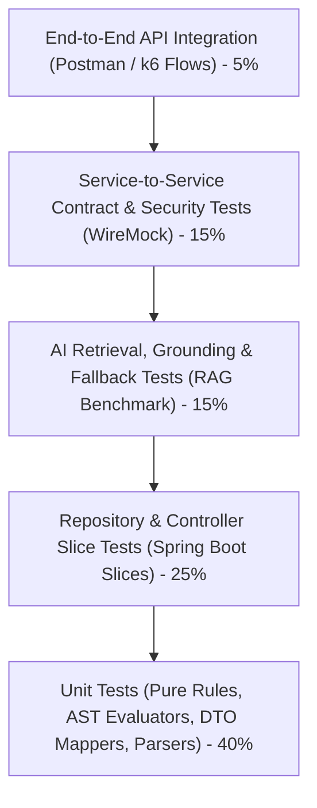

# Prestiq Microservices Testing Strategy & Quality Assurance Framework

**Document Version:** 2.0.0  
**Testing Frameworks:** JUnit 5, AssertJ, Mockito, WireMock (`Java Services`) | Pytest, pytest-asyncio, pytest-mock (`Python Services`)  
**Hardware Target:** MacBook Air M2 (8 GB Unified Memory) Optimization  

---

## 1. Microservices Testing Pyramid

Each microservice is maintained with an independent test suite that can be executed in isolation without requiring the rest of the microservices ecosystem to be running:



---

## 2. Low-Memory Test Execution Workflow (8 GB M2 Optimization)

Running 11 microservices plus Dockerized test environments would quickly cause memory swapping on an 8 GB MacBook Air M2. Prestiq optimizes test execution as follows:

1. **Per-Service Isolated Execution:**
   * Developers run tests only for the service they are modifying:
     ```bash
     # Executes in ~4-8 seconds, consumes < 200 MB RAM
     cd services/eligibility-service && ./mvnw test
     ```
2. **WireMock for Inter-Service Stubs:**
   * Downstream service calls (e.g. `student-service` fetching data for `eligibility-service`) are stubbed using in-memory **WireMock**:
     ```java
     // Stub student-service response in eligibility-service integration test
     stubFor(get(urlEqualTo("/internal/v1/students/student-123/profile"))
         .willReturn(aResponse()
             .withHeader("Content-Type", "application/json")
             .withBody("{ \"cumulativeGpa\": 3.85, \"gpaScale\": 4.0 }")));
     ```
   * Eliminates the need to spin up multiple services or Docker containers during local testing.
3. **Native PostgreSQL for Repository Tests:**
   * Local integration tests connect to a lightweight local test database (`prestiq_test_db`) running on native PostgreSQL (`localhost:5432`), avoiding the 2.5 GB Docker Desktop memory footprint.
   * In CI/CD pipelines (GitHub Actions), **Testcontainers** spins up containerized PostgreSQL instances automatically.

---

## 3. Eligibility Engine Deterministic Test Suite (`eligibility-service`)

The pure deterministic rule engine must pass 100% of the canonical test matrix scenarios:

| Test ID | Scenario | Input Profile | Rule Criteria | Expected Verdict | Expected Explanation |
| :--- | :--- | :--- | :--- | :--- | :--- |
| **ELIG-01** | All-Pass | GPA: 3.85, Major: CS, Country: US | Min GPA: 3.5, Major: STEM, Country: US | `ELIGIBLE` | All criteria satisfied (100% match). |
| **ELIG-02** | Boundary Pass | GPA: 3.500 | Min GPA: 3.50 | `ELIGIBLE` | GPA 3.50 meets minimum threshold. |
| **ELIG-03** | Boundary Fail | GPA: 3.499 | Min GPA: 3.50 | `INELIGIBLE` | GPA 3.499 is below required 3.50. |
| **ELIG-04** | Missing Mandatory | GPA: `null`, Country: US | Min GPA: 3.5, Country: US | `NEEDS_VERIFICATION` | Flags `cumulativeGpa` as missing data. |
| **ELIG-05** | Missing Data + Fail | GPA: `null`, Country: UK | Min GPA: 3.5, Country: US | `INELIGIBLE` | Country mismatch preempts missing GPA. |
| **ELIG-06** | Preferred Bonus | First-Gen: true, GPA: 3.7 | Min GPA: 3.5, First-Gen: Preferred (+15%) | `ELIGIBLE` | 100% mandatory + 15% bonus. |
| **ELIG-07** | Scale Conversion | GPA: 8.8 (Scale: 10.0) | Min GPA: 3.5 (Scale: 4.0) | `ELIGIBLE` | Normalized GPA = 3.52 $\ge$ 3.50. |

---

## 4. Multi-Provider AI Service & RAG Evaluation (`ai-service`)

Testing `ai-service` requires validating both provider fallback behaviors and response grounding without incurring paid API charges:

### 4.1 Mock Adapter Testing (Zero Network I/O)
* Unit tests utilize a `MockLLMProvider` that simulates standard responses, simulated latency, and error codes (`429 Too Many Requests`, `503 Service Unavailable`).
* **Fallback Verification Test:** Verify that when Gemini throws `ResourceExhaustedException` (HTTP 429), the provider factory immediately dispatches the request to Groq without failing the student query.

### 4.2 Automated RAG Grounding Benchmark (50 Golden Test Cases)
Executed against real free-tier endpoints during integration testing:

| Metric | Target Standard | Verification Method |
| :--- | :--- | :--- |
| **Faithfulness / Groundedness** | $\ge 95\%$ | Automated N-gram and claim overlap check against retrieved source chunks. |
| **Hallucination Rate** | $\le 2\%$ (Target: $0\%$) | Asserts that dates, dollar amounts, and requirements match source chunks exactly. |
| **Insufficient Evidence Handling** | $100\%$ | When queried on unmentioned topics, model correctly returns standardized refusal with official portal link. |
| **Prompt Injection Block Rate** | $100\%$ | 50 adversarial prompts (e.g. "ignore previous constraints") must all produce standard refusals. |

---

## 5. Production-Readiness Acceptance Criteria

Prior to promoting any microservice release to production:

- [ ] **Autonomous Test Pass:** All unit and WireMock integration tests pass cleanly per service.
- [ ] **Flyway/Alembic Migration Idempotency:** Migrations execute forward and backward cleanly against native test database.
- [ ] **Zero Hardcoded Secrets:** Scanned with automated GitGuardian/TruffleHog rules to ensure zero API keys or passwords in repository history.
- [ ] **Zero Fabricated Opportunities:** Verified that mock test opportunities are explicitly flagged as `MOCK_TEST` and excluded from public catalog queries.
- [ ] **Rate Limiting Active:** Rate limiter correctly throttles excessive requests on `/api/v1/auth/login` and `/api/v1/assistant/chat`.
- [ ] **Health Checks Verified:** Each service exposes `/actuator/health` or `/healthz` verifying database connectivity.
