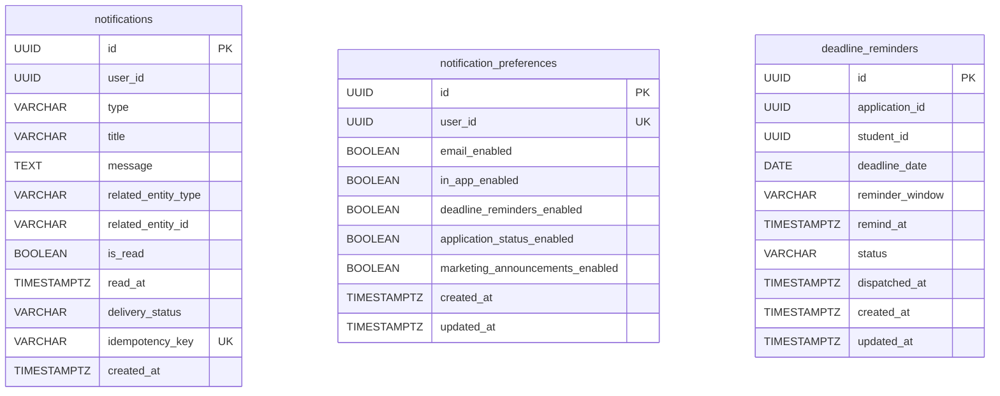

# PrestIQ Notification Service (`notification-service`)

The **Notification Service** provides in-app notifications, user category preferences, and a scheduled countdown engine for scholarship and application deadline reminders within the PrestIQ platform.

---

## 1. Service Specifications

| Characteristic | Specification |
|---|---|
| **Port** | `8087` (Configurable via `NOTIFICATION_SERVICE_PORT`) |
| **Database** | PostgreSQL `prestiq_notification_db` |
| **Java Version** | Java 21 (LTS) |
| **Framework** | Spring Boot 3.3.5 |
| **Build Tool** | Apache Maven with Maven Wrapper (`./mvnw`) |
| **ORM & Migrations** | Spring Data JPA (Hibernate) + Flyway Migrations |
| **API Documentation** | Springdoc OpenAPI 3.0 (`/swagger-ui.html`, `/v3/api-docs`) |
| **Memory Footprint** | Bounded JVM heap (`-Xms64m -Xmx256m`) configured in `.mvn/jvm.config` |

---

## 2. Domain & Database Architecture

The database schema is managed via Flyway (`V1__init_notification_schema.sql`).



### Key Schema Constraints
- **Notifications Idempotency:** `CONSTRAINT uq_notifications_idempotency UNIQUE (idempotency_key)` guarantees that identical webhook / internal events cannot trigger duplicate notifications.
- **Deadline Reminder Deduplication:** `CONSTRAINT uq_deadline_reminders UNIQUE (application_id, reminder_window, deadline_date)` guarantees concurrency-safe deduplication for reminder windows.
- **User Preferences:** `user_id UNIQUE` constraint guarantees a single canonical preferences record per student.

---

## 3. Deadline Reminder Engine & Countdown Lifecycle

### Reminder Windows
The engine supports configurable countdown windows (default `30,7,1`):
- `30_DAYS_BEFORE`: Dispatched 30 days prior to the deadline at 09:00 UTC.
- `7_DAYS_BEFORE`: Dispatched 7 days prior to the deadline at 09:00 UTC.
- `1_DAY_BEFORE`: Dispatched 1 day prior to the deadline at 09:00 UTC.

### Lifecycle & Concurrency-Safe Deduplication
1. **Scheduling:** When an application is created or its deadline adjusted in `application-service`, it invokes `POST /internal/v1/notifications/deadlines`.
2. **Window Pruning:** Reminders with target timestamps already in the past relative to the system `Clock` are skipped.
3. **Execution & Batching:** `DeadlineReminderScheduler` runs hourly (or on-demand via `POST /internal/v1/notifications/process-reminders`), pulling pending reminders in bounded pages (`batch-size = 50`) where `remind_at <= clock.instant()`.
4. **Resilience & Fallback:** If `application-service` is temporarily unreachable to resolve scholarship metadata, the engine dispatches a fallback reminder without failing the countdown run.
5. **Preferences Enforcement:** If a student disables deadline reminders in `notification_preferences`, the reminder is transitioned to `SKIPPED` without generating in-app noise.
6. **Cancellation:** If an application is withdrawn or cancelled, `POST /internal/v1/notifications/deadlines/cancel` transitions pending reminders to `CANCELLED`.

---

## 4. API Endpoints

### Authenticated User Endpoints (`/api/v1/notifications`)
All user endpoints require Bearer JWT authentication. Student ownership is strictly verified.

| Method | Endpoint | Description |
|---|---|---|
| `GET` | `/api/v1/notifications` | Paginated listing of notifications (`unreadOnly`, `type`, `page`, `size`) |
| `GET` | `/api/v1/notifications/unread-count` | Returns total unread count for the authenticated student |
| `PATCH` | `/api/v1/notifications/{id}/read` | Marks a specific notification as read (enforces ownership) |
| `POST` | `/api/v1/notifications/mark-all-read` | Marks all unread notifications for the student as read |
| `DELETE` | `/api/v1/notifications/{id}` | Deletes / dismisses a notification (enforces ownership) |
| `GET` | `/api/v1/notifications/preferences` | Gets student preferences (creates default if none exist) |
| `PUT` | `/api/v1/notifications/preferences` | Updates category preferences (`deadlineRemindersEnabled`, etc.) |

### Protected Internal Endpoints (`/internal/v1/notifications`)
Requires `X-Internal-Service-Key` matching `prestiq.security.internal-service-key` or `ROLE_INTERNAL`/`ROLE_ADMIN`.

| Method | Endpoint | Caller | Description |
|---|---|---|---|
| `POST` | `/internal/v1/notifications/deadlines` | `application-service` | Schedules 30d, 7d, 1d countdown reminders |
| `POST` | `/internal/v1/notifications/deadlines/cancel` | `application-service` | Cancels pending reminders on withdrawal |
| `POST` | `/internal/v1/notifications/application-status` | Internal microservices | Dispatches application status change notification |
| `POST` | `/internal/v1/notifications/process-reminders` | Scheduler / Operations | Triggers deadline reminder engine execution |

---

## 5. Security & Isolation

- **Stateless JWT Validation:** Validates HMAC-SHA256 tokens using `JwtTokenValidator`.
- **Identity Header Protection:** Inbound `X-User-Id` and `X-User-Roles` headers from clients are discarded; identity is derived exclusively from validated JWT claims.
- **Service-Level Ownership Verification:** Users can only view, read, or delete their own notifications.
- **Zero Secrets Logging:** Secrets and sensitive notification payloads are never output to log streams.

---

## 6. Running and Testing Locally

### Prerequisites
- JDK 21 LTS (`export JAVA_HOME=$(/usr/libexec/java_home -v 21)`)
- Maven 3.9+ (via `./mvnw`)
- PostgreSQL (for standalone execution) or in-memory H2 (for tests)

### Build and Run Tests
```bash
cd services/notification-service
export JAVA_HOME=$(/usr/libexec/java_home -v 21)

# Run test suite
./mvnw clean test

# Package JAR
./mvnw clean package
```

### Run Service
```bash
export NOTIFICATION_SERVICE_PORT=8087
export NOTIFICATION_DB_URL=jdbc:postgresql://localhost:5432/prestiq_notification_db
export NOTIFICATION_DB_USERNAME=prestiq_user
export NOTIFICATION_DB_PASSWORD=prestiq_password
export JWT_SECRET=0123456789012345678901234567890123456789012345678901234567890123
export INTERNAL_SERVICE_KEY=prestiq-internal-dev-secret-key-2026

./mvnw spring-boot:run
```

---

## 7. Known Limitations & Verification Status

- **PostgreSQL vs H2:** Integration tests execute against H2 using `MODE=PostgreSQL`. Both SQL schemas and Flyway scripts use standard SQL `TIMESTAMP WITH TIME ZONE` and ANSI constraints verified for direct PostgreSQL compatibility.
- **Email / SMS Dispatches:** In-app notifications are the authoritative notification mechanism in this milestone. Email/SMS adapters remain reserved for a future external messaging integration phase.
